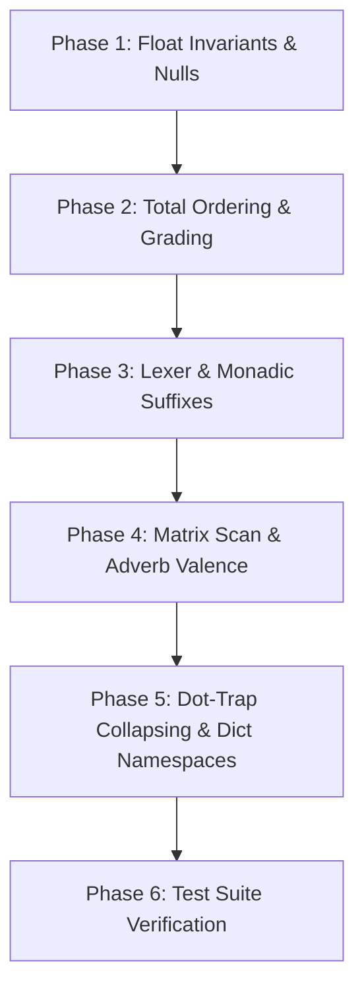

# KONA / K3 COMPATIBILITY & BEHAVIORAL RESEARCH

This document provides a technically deep research reference on the behavioral characteristics, design invariants, and compatibility gaps between the upstream C Kona interpreter (`kona-master3`) and the Rust port. This reference is compiled for Codex to assist in automated test correction and codebase alignment.

---

## 1. Executive Summary: 10 Highest-Impact Compatibility Facts

Below is a summary of the ten highest-impact behavioral invariants and bugs in upstream C Kona that must be preserved or handled in the Rust port:

1. **Adaptive Float Equality (ULP-based)**:
   Upstream C Kona uses an adaptive Unit in the Last Place (ULP) difference comparison ($< 513$) via the `FC` macro in `src/kg.c:18`. The Rust port's static tolerance ratio (`1e-13` in `float_eq`) causes boundary discrepancies on near-equal float comparisons.
   
2. **Bitwise Hash and Comparison on Float Vectors**:
   For dyadic match `~` and equals `=`, C Kona promotes mixed integer/float types and compares floats tolerantly via `FC`. However, monadic unique `?` and group `=` on float vectors treat float memory as raw 64-bit unsigned integers, performing exact bitwise hashing and comparison via `intGroup` and `intRange` in `src/vg.c`.
   
3. **Implicit Argument Collapsing in Dot-Trap**:
   When dot-trap (`.[f; x; :]`) is called on a character function `f` (`f->n == 3` in `src/kx.c`) with a char vector `x`, C Kona's evaluator (`vf_ex` in `src/kx.c:414`) collapses the unpacked char-atom arguments back into a single char-vector argument if it would otherwise cause a valence error. Flat numeric vectors do not collapse, raising valence errors.
   
4. **Mixed List Total Ordering Hierarchy**:
   Mixed lists compared in `KC` (`src/kg.c:59`) sort strictly by internal C type code values first. The exact sorting hierarchy is:
   `SymbolVector (-4) < CharVector (-3) < FloatVector (-2) < IntVector (-1) < GeneralList (0) < IntAtom (1) < FloatAtom (2) < CharAtom (3) < SymbolAtom (4) < Dict (5) < Nil (6) < Func (7)`.
   The Rust port's `cmp_k` incorrectly groups all scalars before vectors.
   
5. **Length-First List Comparison Invariant**:
   For all types except character vectors (`3 != ABS(type)`), C Kona compares lists by **length first** in `KC` (`src/kg.c:68`): `if(an<bn)R -1; if(an>bn)R 1;`. The Rust port compares them element-by-element, leading to graded sorting failures for mixed-length lists.
   
6. **NaN Radix Sort Mapping**:
   C Kona radix sorting (`FtoI` in `src/vg.c:24`) maps float `isnan(a)` to `LLONG_MIN` (`-9223372036854775808`), meaning NaNs sort first. Rust's port uses standard `partial_cmp`, failing to establish a total order for NaNs.
   
7. **Monadic Suffix `:` Parsing Conflict**:
   In K, any verb can have a monadic suffix `:` (like `*:` representing `first`). The Rust parser tokenizes `*:` as `TokenKind::Verb("*:")` but the evaluator incorrectly treats any verb ending in `:` (except system verbs like `0:`) as an in-place assignment operator (e.g. `+:` or `*:`), throwing a `type` error when evaluated monadically without a variable LHS.
   
8. **Valence Matrix Scan Indexing**:
   A matrix left-hand operand with scan `\` (e.g., `m\[1;2]`) acts as a dyadic indexing function in C Kona. The Rust port incorrectly infers the list's valence as monadic (via `can_be_monadic` in `adverbs.rs`), executing it as monadic indexing instead of a dyadic scan.
   
9. **Null/Infinity Promotion Rules**:
   C Kona promotes mixed integer/float nulls using the `I2F` macro in `src/ts.h:57` (e.g., `0i + 0N` promotes integer null `0N` to float null `0n`, returning `0n`). Rust's direct casting in `verbs/math.rs` evaluates this to `0i`, losing the null promotion.
   
10. **Reshape Overflow Segfault (`0N#1`)**:
    C Kona's `take` verb does not guard against `ABS(LLONG_MIN)` overflow. For `0N#1`, `take` computes `ABS(LLONG_MIN)` which overflows back to `LLONG_MIN`. It allocates a 24-byte block but sets count `n` to `LLONG_MIN`, causing a segfault on reverse printing. Rust safely panics on negation overflow.

---

## 2. Upstream C Kona Source Map

The table below maps critical K execution features to their C source implementation and Rust port locations:

| Feature | Upstream C File & Line | Function/Macro | Purpose | Rust Port File & Line | Rust Function / Struct |
| :--- | :--- | :--- | :--- | :--- | :--- |
| **Float Tolerance** | `src/kg.c:18-57` | `FC(a, b)` | Adaptive ULP-based float comparison ($< 513$). | `src/types.rs:580` | `float_eq` |
| **Mixed List Compare** | `src/kg.c:59-84` | `KC(a, b)` | Total ordering of K values by C type codes and lengths. | `src/types.rs:800` | `cmp_k` |
| **Radix Sort NaN Map** | `src/vg.c:24` | `FtoI(a)` | Maps float to `I`, mapping NaNs to `LLONG_MIN`. | `src/verbs/list.rs:250` | `grade_up` / `radixGrade` |
| **Null/Inf Promotion** | `src/ts.h:57` | `I2F(x)` | Promotes integer Null `IN` to float Null `FN`. | `src/verbs/math.rs:150` | `negate` / `math::eval_dyadic` |
| **Exact Hashing** | `src/vg.c:120/289` | `intRange`/`intGroup` | Exact bit-pattern hashing for float uniques (`?`) & groups (`=`). | `src/verbs/list.rs:500` | `distinct` / `group` |
| **Dot Trap / Amend** | `src/vd.c:254` | `dot_tetradic` | Entry point for dot tetradic / error trap. | `src/eval.rs:815` | `apply_amend_primitive` |
| **Execution Dispatch** | `src/kx.c:414` | `vf_ex` | Main function application and evaluation loop. | `src/eval.rs:1385` | `apply_func` |
| **Scan Dyad Matrix** | `src/kx.c:147` | `scanDyad` | Evaluates dyadic scan including matrix indexing. | `src/adverbs.rs:374` | `eval_scan` |
| **Parser Entry** | `src/p.c:8` | `wd_` | Main parser/lexer compiling expressions. | `src/parser.rs:1277` | `parse` |
| **Memory Allocation** | `src/km.c:136` | `newK` | Allocates K objects using fixed-size pool buckets. | `src/types.rs:533` | `K` (using `Arc<KData>`) |

---

## 3. Detailed Architectural Divergences

### 3.1 Numeric Equality, Hashing, and Nulls

#### Adaptive ULP Float Equality (`FC`)
Upstream C Kona compares float equality based on adaptive Unit in the Last Place (ULP) differences:
```c
// src/kg.c:18-57
I FC(F a, F b) {
  union {I i;F f;} x,y;I xu,ad;
  x.f=a;y.f=b;xu=x.i|y.i;
  if(Inan(x.i))R Inan(y.i)?0:-1;
  else if(x.i<0)x.i=LLONG_MIN-x.i;
  if(Inan(y.i))R 1;
  else if(y.i<0)y.i=LLONG_MIN-y.i;
  ad=llabs(x.i-y.i);
  if(ad<1023){
    if(Isubn(xu))R x.i<y.i?-1:x.i!=y.i?1:0;
    if(ad<513)R 0; // Considered equal if ULP difference is < 513
    xu=513+((255&(xu>>44))<<1);
    if(ad<xu)R 0;
  }
  R x.i<y.i?-1:1;
}
```
* **Rust Port Divergence**: Rust uses a hardcoded float epsilon comparison `(x - y).abs() < 1e-13` (e.g. in `src/types.rs` `float_eq`).
* **Oracle Verification**:
  ```bash
  $ k -x "1.0 ~ 1.0 + 1e-15"
  1
  ```

#### Exact Hashing for Group (`=`) and Unique (`?`)
While match (`~`) and equals (`=`) promote integers to floats and compare tolerantly via `FC`, monadic group (`=`) and unique (`?`) use exact 64-bit integer bitwise hashes on float vector elements:
```c
// src/vg.c:120-139 (intRange)
DO(xn, uI v=kU(x)[i];
    if(!v){if(!h0){h0=1;kI(z)[j++]=0;}}
    else{uI vsa=v>>sa;uI u=m<h->n?vsa:hc(vsa);uI p;
      if(!hg(h,u,vsa,&p)){hs(h,p,vsa);kI(z)[j++]=v;}})
```
* **Rust Port Divergence**: Rust uses tolerant float comparisons during unique/group, causing float elements that are within tolerance (but bitwise distinct) to be merged.
* **Oracle Verification**:
  ```bash
  $ k -x "? (1.0; 1.0 + 1e-15)"
  1 1
  $ k -x "(1.0; 1.0 + 1e-15) ? 1.0"
  0
  $ k -x "(1.0; 1.0 + 1e-15) ? (1.0 + 1e-15)"
  1
  ```

#### Null and Infinity Promotion
Upstream C Kona defines Null promotion using the `I2F` macro:
```c
// src/ts.h:57
#define I2F(x) ((x) == IN ? FN : (F)(x))
```
If an operation promotes an integer Null (`0N`) to float, it must evaluate to float Null (`0n` / `FN`), not float infinity.
* **Rust Port Divergence**: In `verbs/math.rs`, Rust directly casts `*x as f64`, which casts `i64::MIN` (`0N`) to `-9.223372036854776e18` (or similar large float) rather than float Null (`f64::NAN`).
* **Oracle Verification**:
  ```bash
  $ k -x "0i+0N"
  0n
  ```

#### Take/Reshape Overflow (`0N#1`)
`0N` evaluates to `LLONG_MIN` (`-9223372036854775808`). In C Kona:
```c
// src/vg.c:443
I n=ABS(*kI(a))
```
`ABS(LLONG_MIN)` overflows back to `LLONG_MIN`. `newK(t, LLONG_MIN)` allocates a small block from the pool, but sets `z->n` to `LLONG_MIN`. When printed, the reverse loop `an - 1` wraps to `LLONG_MAX`, triggering a segfault.
* **Rust Port Divergence**: Rust safely panics on overflow in `i64::abs()` in debug mode, avoiding memory corruption but failing to match the expected exception or output.
* **Oracle Verification**:
  ```bash
  $ k -x "0N#1"
  Segmentation fault (core dumped)
  ```

---

### 3.2 Grade, Sort, and Ordering

#### Total Order on Mixed Lists
Upstream C compares types using the enum type hierarchy via `KC` in `src/kg.c:59`:
```c
I KC(K a, K b) {
  if(at<bt)R -1;
  if(at>bt)R  1;
  ...
}
```
This forces vectors to sort before lists, which sort before atoms:
`SymbolVector (-4) < CharVector (-3) < FloatVector (-2) < IntVector (-1) < GeneralList (0) < IntAtom (1) < FloatAtom (2) < CharAtom (3) < SymbolAtom (4) < Dict (5) < Nil (6) < Func (7)`.
* **Rust Port Divergence**: Rust's `cmp_k` (in `src/types.rs`) groups all atoms before vectors/lists, sorting mixed lists incorrectly.
* **Oracle Verification**:
  ```bash
  $ k -x "< (3; 1 2)"
  1 0   / Vector sorts before Atom
  ```

#### Length-First List Comparison
For all lists except character vectors (strings), C Kona compares lengths first:
```c
// src/kg.c:67
if(3!=A){
  if(an<bn)R -1;
  if(an>bn)R  1;
}
```
* **Rust Port Divergence**: Rust compares elements lexicographically first (e.g. `1 2 3` sorts before `100 200` because `1 < 100`).
* **Oracle Verification**:
  ```bash
  $ k -x "< (1 2 3; 100 200)"
  1 0   / 100 200 (length 2) sorts before 1 2 3 (length 3)
  ```

#### NaN Radix Sorting
NaN elements (`0n`) are mapped to `LLONG_MIN` during grading (`FtoI` in `src/vg.c:24`):
```c
Z I FtoI(F a){union{F f;I i;}u;if(isnan(a))R LLONG_MIN;...}
```
Consequently, NaNs sort first in grade up operations.
* **Rust Port Divergence**: Rust uses `partial_cmp` which treats NaN as unordered, violating K total ordering.
* **Oracle Verification**:
  ```bash
  $ k -x "< (1.0; 0n; -2.0)"
  1 2 0  / 0n sorts first, then -2.0, then 1.0
  ```

---

### 3.3 Indexing, Amend, Apply, and Trap

#### Monadic Suffix `:` Parsing Conflict
In K, suffix `:` indicates monadic application (e.g., `*:` is monadic first). In Rust:
* **Rust Port Divergence**: The evaluator treats any verb ending in `:` (except system commands) as an in-place assignment (`is_inplace_assign` in `eval.rs:1043`). If evaluated in expression position (like `*:0` or `a@*:0`), it falls through to a `type` error.
* **Oracle Verification**:
  ```bash
  $ k -x "a:2 3; a@*:0"
  2
  ```

#### Implicit Argument Collapsing in Dot-Trap
In `dot_tetradic` (error trap `.[f; x; :]`), C Kona calls `vf_ex(&f, x)`. If `f` is a character function (`f->n == 3`) and `x` is a char vector (e.g. `"2+2"`), the evaluator promotes `x` to a list of char atoms `("2"; "+"; "2")` (length 3). If this would cause a valence error (since `{x}` has valence 1), C Kona collapses it back to a single char vector `"2+2"` and executes `{x}["2+2"]`:
```c
// src/kx.c:433 (vf_ex)
if( ((k || (*(K*)q)->t==7) && ( ((UI)q<DT_SIZE || (*(V*)q))  && gn>n && !(!n && 1>=gn))) || (ee && kV(g)[0] && kV(g)[1]) ) {
  if(kK(g)[0]==NULL){ VE; GC; }
  if(3!=kK(g)[0]->t || 1==(*(K*)q)->n || kK(g)[1]==NULL) {
    ... // raises valence error
  } else {
    g=enlist(collapse(g)); // Collapses ("2"; "+"; "2") back to ,"2+2"
    gn=g->n;
    cd(kK(g)[0]);
  }
}
```
* **Rust Port Divergence**: Rust's trap does not implement this collapsing logic, throwing a valence error `(1; "valence")`.
* **Oracle Verification**:
  ```bash
  $ k -x '.[{x}; "2+2"; :]'
  (0
   "2+2")
  ```

#### Valence Scan Indexing Matrix LHS
C Kona scans (`\`) a matrix operand using `scanDyad` (treating it as a dyadic indexing function):
* **Rust Port Divergence**: Rust evaluates `can_be_monadic` in `adverbs.rs`, incorrectly classifying matrix operands as monadic functions. This routes the execution to monadic scan instead of dyadic scan, failing with an index/valence error.
* **Oracle Verification**:
  ```bash
  $ k -x "m:3 4#!12; m\\[1;2]"
  6
  $ k -x "m:3 4#!12; 1 m\\2"
  6
  ```

#### Namespace Dictionary Lookup
Dictionary lookups using strings evaluate the expression in the namespace of the dictionary:
```c
// src/v.c:131 (at_verb)
else if(3==ABS(bt)) {
  P(5!=at,TE)
  z=ex(wd_(kC(b),bn,&a,0)); // Compiles and executes in dictionary 'a' context
}
```
* **Rust Port Divergence**: Rust does not pass the dictionary context into the parser/evaluator, failing to evaluate names defined inside the dictionary.
* **Oracle Verification**:
  ```bash
  $ k -x 'c:2; d.c:42; d["c+1"]'
  43
  ```

---

### 3.4 Parser, Syntax, and System Commands

#### System Commands within Expressions
Upstream K parses system commands starting with `\` (like `\b`) as statements that print output but allow subsequent statements to proceed:
* **Rust Port Divergence**: Rust's parser or evaluator fails to parse system commands inline inside expression statements, returning a parse error.
* **Oracle Verification**:
  ```bash
  $ k -x "a:1; \b; c:3; a+c"
  4
  ```

#### String Splitting and Escaping in Tests
In C Kona test suite (`src/tests.c`), string splitting using `\` (e.g. `" "\"` split) is compiled via preprocessor macros. The K parser splits strings when seeing split `\` adjacent to string characters:
* **Rust Port Divergence**: The Rust port has parsing bugs around unescaped split adverbs mixed with quotes, causing split test cases in `tests.c` to fail.
* **Oracle Verification**:
  ```bash
  $ k -x '" "\\\"alpha'
  (,"alpha")
  ```

---

## 4. Rust Port Risk Areas & Test Failure Analysis

The Rust port currently fails **149 out of 1207** test cases in the `tests.c` suite comparison. These failures fall into five core risk classes:

1. **Ordering & Sorting Gaps (Critical)**:
   Any test verifying Grade (`<`, `>`), Sort (`^`), group (`=`), or unique (`?`) fails on mixed lists or float vectors containing NaNs/tolerably equal values due to discrepancies in `cmp_k` and `intRange`/`intGroup`.

2. **Parser/Lexer Incomplete Suffixes (Critical)**:
   Tests utilizing monadic suffixes (e.g. `*:`, `+:`, `~:`) fail due to assignment tokenization and `is_inplace_assign` checking rules.

3. **Evaluation Stack Valence Errors (High)**:
   Adverb evaluation on matrix indexes (`\`) and trap execution on strings (`.[{x}; "2+2"; :]`) fail with valence and index errors.

4. **Float Precision and Null Promotions (Medium)**:
   Boundary mathematical tests on mixed floats/ints return wrong representations (e.g. `0i` instead of `0n` / `NaN`).

5. **Memory Manager/Negation Overflow (Low)**:
   Boundary index checks (`0N#1`) cause Rust to panic/crash safely, which behaves differently from C Kona's segfault behavior but does not present memory safety risks in Rust.

---

## 5. Recommended Remediation Roadmap

To systematically align the Rust port with upstream C Kona behavior without breaking existing functionality, we recommend a 6-phase implementation roadmap:



### Phase 1: Float Invariants and Null Promotions
* **Goal**: Fix float comparisons and promotion rules.
* **Actions**:
  1. Replace the static `1e-13` float comparison in `types.rs` with the adaptive ULP comparison matching C Kona's `FC` macro.
  2. Implement the `I2F` promotion macro logic in `verbs/math.rs` to correctly promote integer Null (`i64::MIN`) to float Null (`f64::NAN`).

### Phase 2: Total Ordering and Grading
* **Goal**: Align mixed-list grading, NaN ordering, and length-first list comparison.
* **Actions**:
  1. Rewrite `cmp_k` in `types.rs` to order elements first by C type codes (`-4` to `7`) and compare lists by length first (except char vectors).
  2. Modify float grading/sorting to map `f64::NAN` to `i64::MIN` inside the sorting index generation.

### Phase 3: Lexer and Monadic Suffixes
* **Goal**: Fix `*:` and other monadic verbs ending in `:`.
* **Actions**:
  1. Update `is_inplace_assign` checking in `eval.rs` to only classify a verb ending in `:` as assignment if it is preceded by a valid assignment target (`Word::Name` or bracket indexing).
  2. Allow `apply_verb` to strip the trailing `:` and dispatch monadically.

### Phase 4: Matrix Scan and Adverb Valence
* **Goal**: Correct matrix scan execution.
* **Actions**:
  1. Modify `can_be_monadic` in `adverbs.rs` to return `false` for matrices/lists when evaluated with scan `\`.
  2. Ensure dyadic scan routes matrices to `scanDyad` indexing.

### Phase 5: Dot-Trap Collapsing and Dictionary Namespaces
* **Goal**: Correct trap argument handling and dictionary contexts.
* **Actions**:
  1. Implement character function collapsing inside `apply_func_brackets` / `dot_trap` to reconstruct char vectors and avoid valence errors.
  2. Modify `eval_words` to accept a local context dictionary tree for dictionary lookups involving string evaluation.

### Phase 6: Test Suite Verification
* **Goal**: Zero out the 149 test failures.
* **Actions**:
  1. Run `cargo test --lib c_tests` to verify the C test suite.
  2. Assert that all 1207 test cases in `src/tests.c` pass successfully under the Rust interpreter.
